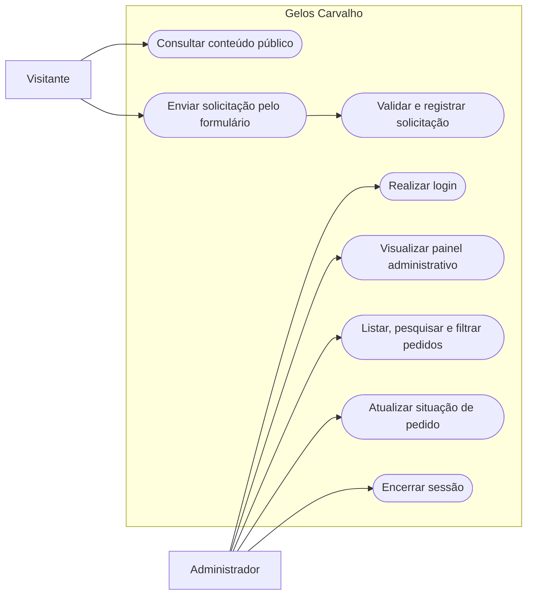
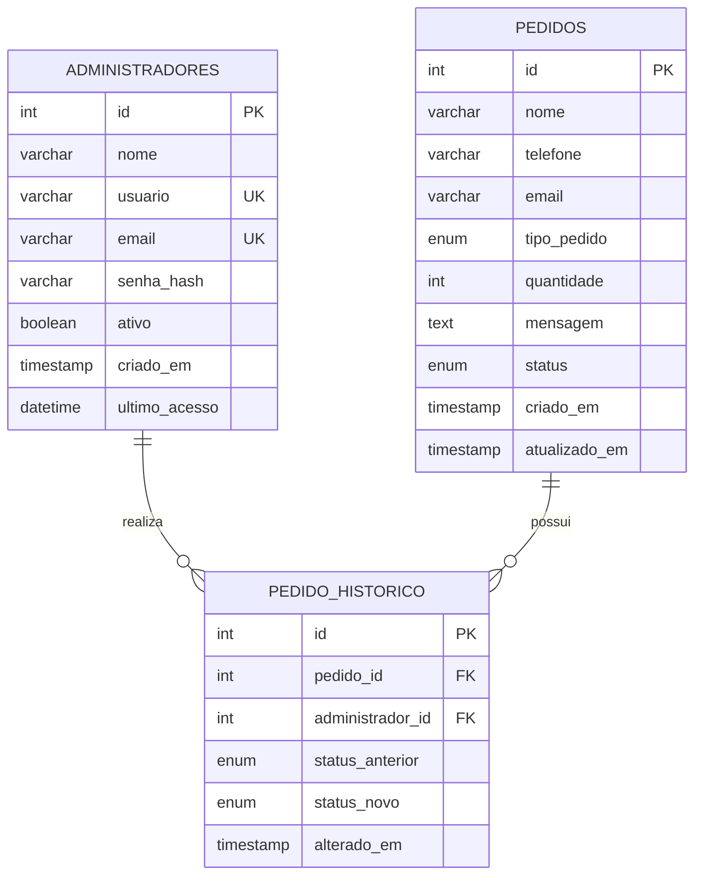
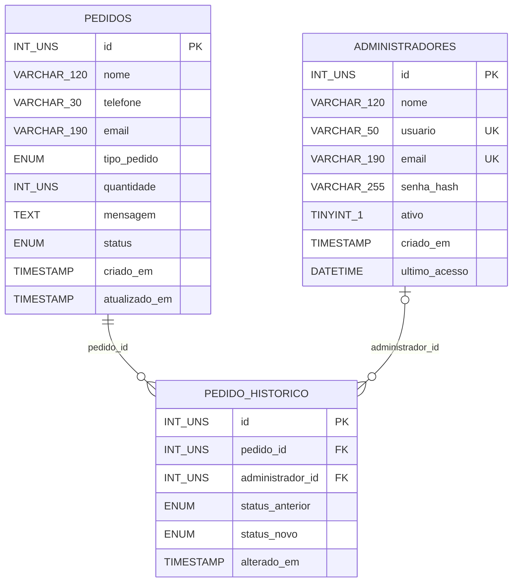

# INSTITUTO FEDERAL DE EDUCAÇÃO, CIÊNCIA E TECNOLOGIA BAIANO

## CAMPUS BOM JESUS DA LAPA

### CURSO TÉCNICO EM INFORMÁTICA INTEGRADO

<br>

# PROJETO DE SOFTWARE

# GELOS CARVALHO

<br><br>

**Bom Jesus da Lapa – BA**  
**2026**

---

# INSTITUTO FEDERAL DE EDUCAÇÃO, CIÊNCIA E TECNOLOGIA BAIANO

## CAMPUS BOM JESUS DA LAPA

### CURSO TÉCNICO EM INFORMÁTICA INTEGRADO

<br>

**Arthur Carvalho de Souza**

<br><br>

# PROJETO DE SOFTWARE

# GELOS CARVALHO

**Site institucional e sistema de gerenciamento de pedidos**

<br>

Projeto de Software desenvolvido no contexto do Curso Técnico em Informática Integrado do Instituto Federal Baiano — Campus Bom Jesus da Lapa.

<br><br>

**Bom Jesus da Lapa – BA**  
**2026**

---

# SUMÁRIO

1. DESCRIÇÃO GERAL DO SISTEMA
   - 1.1 Apresentação do projeto e objetivos
   - 1.2 Público-alvo
   - 1.3 Arquitetura geral do sistema
     - 1.3.1 Camada de apresentação
     - 1.3.2 Camada de aplicação
     - 1.3.3 Camada de persistência
     - 1.3.4 Fluxo geral de funcionamento
   - 1.4 Estrutura funcional do website
     - 1.4.1 Área pública
     - 1.4.2 Formulário de contato e pedidos
     - 1.4.3 Painel administrativo
     - 1.4.4 Gerenciamento de pedidos
   - 1.5 Perfis de usuário e controle de acesso
   - 1.6 Autenticação e segurança
     - 1.6.1 Sessão e autenticação
     - 1.6.2 Proteção de senhas
     - 1.6.3 Proteção contra SQL Injection
     - 1.6.4 Proteção CSRF e autorização
     - 1.6.5 Validação, sessões e tratamento de erros
   - 1.7 Regras de negócio
   - 1.8 Estrutura de arquivos
2. REQUISITOS DO SISTEMA
   - 2.1 Requisitos funcionais
   - 2.2 Requisitos não funcionais
   - 2.3 Estratégia de testes
     - 2.3.1 Testes da área pública e formulário
     - 2.3.2 Testes de autenticação e autorização
     - 2.3.3 Testes de pedidos
     - 2.3.4 Testes de segurança e integridade
3. MODELO DE CASOS DE USO E DIAGRAMAS DE CASO DE USO
   - 3.1 Casos de uso
   - 3.2 Atores
   - 3.3 Diagrama de casos de uso
   - 3.4 Descrição dos casos de uso
4. MODELAGEM DE BANCO DE DADOS
   - 4.1 Entidades e dicionário de dados
     - 4.1.1 Entidade administradores
     - 4.1.2 Entidade pedidos
     - 4.1.3 Entidade pedido_historico
   - 4.2 Modelo conceitual
   - 4.3 Modelo relacional
   - 4.4 Integridade e normalização
5. CONCLUSÃO

REFERÊNCIAS

---

# 1 DESCRIÇÃO GERAL DO SISTEMA

## 1.1 Apresentação do projeto e objetivos

O Gelos Carvalho é um website institucional desenvolvido para apresentar a empresa, divulgar seus produtos e serviços e disponibilizar canais de comunicação com clientes interessados na compra de gelo. O website reúne páginas de apresentação, informações institucionais, serviços, galeria de imagens e contato.

A evolução do projeto acrescenta uma camada de aplicação em PHP e um banco de dados MySQL. Com essa integração, as solicitações enviadas pelo formulário deixam de depender de uma simulação executada no navegador e passam a ser recebidas pelo servidor e armazenadas para consulta posterior.

O sistema também possui uma área administrativa protegida por autenticação. Nela, o responsável pelo atendimento pode visualizar indicadores, consultar pedidos recebidos, pesquisar registros, filtrar por situação e atualizar o andamento de cada solicitação.

A aplicação utiliza HTML5, CSS3 e JavaScript na camada de apresentação, PHP no processamento das requisições e MySQL na persistência dos dados. O acesso ao banco é realizado por PDO, com conexão centralizada em `config/database.php`.

A finalidade principal é aproximar a divulgação institucional do processo de atendimento, mantendo o site público e as operações administrativas em uma aplicação integrada.

Os objetivos específicos são:

- Apresentar a empresa e suas informações institucionais.
- Divulgar os produtos e serviços oferecidos.
- Facilitar o contato entre clientes e a empresa.
- Receber solicitações por meio de um formulário eletrônico.
- Validar e armazenar os dados enviados pelos visitantes.
- Disponibilizar um painel autenticado para acompanhamento dos pedidos.
- Permitir pesquisa, filtragem e atualização da situação das solicitações.
- Registrar as alterações de situação para manter a rastreabilidade do atendimento.
- Organizar o código e a persistência de modo a facilitar a manutenção futura.

## 1.2 Público-alvo

O Gelos Carvalho atende a dois grupos principais.

O primeiro é formado por visitantes e potenciais clientes, que acessam o website para conhecer a empresa, consultar os produtos e serviços, visualizar a galeria e entrar em contato por telefone, WhatsApp ou formulário.

O segundo grupo é formado pelos administradores responsáveis pelo atendimento das solicitações. Esses usuários acessam o painel restrito para consultar os pedidos recebidos e atualizar sua situação.

O sistema implementado contempla um perfil administrativo. Não há, nesta versão, cadastro de contas para clientes, área de acompanhamento público de pedidos ou diferenciação entre perfis de administrador e editor.

## 1.3 Arquitetura geral do sistema

A arquitetura segue o modelo cliente-servidor e separa as responsabilidades em três camadas: apresentação, aplicação e persistência. O navegador apresenta as páginas e envia requisições; o servidor PHP processa as regras de negócio e a autenticação; e o MySQL armazena os dados permanentes.

### 1.3.1 Camada de apresentação

A camada de apresentação reúne a estrutura HTML5, os estilos CSS3 e os comportamentos em JavaScript. Ela compreende as páginas públicas do website, os formulários e as telas do painel administrativo.

O arquivo `css/style.css` mantém os estilos da área institucional. A interface administrativa utiliza o arquivo `css/admin.css`, que define os componentes visuais do login, dashboard e gerenciamento de pedidos.

O JavaScript é utilizado para interações da interface pública, como os comportamentos da navegação, galeria e máscara de telefone. O processamento definitivo do formulário, entretanto, é realizado no servidor.

### 1.3.2 Camada de aplicação

A camada de aplicação é implementada em PHP. Ela recebe os dados do formulário de contato, valida os campos, verifica o token CSRF e grava as solicitações no banco de dados.

Na área administrativa, o PHP autentica o administrador, mantém a sessão, verifica o acesso às páginas protegidas, consulta os pedidos, aplica filtros e atualiza a situação dos registros.

As principais responsabilidades estão distribuídas entre os arquivos `pedido.php`, `login.php`, `admin/index.php`, `admin/pedidos.php` e `admin/atualizar_status.php`. Funções compartilhadas de sessão, autenticação, CSRF e mensagens estão centralizadas em `includes/bootstrap.php`.

### 1.3.3 Camada de persistência

O MySQL armazena as contas administrativas, os pedidos enviados pelos visitantes e o histórico das alterações de situação.

A conexão é centralizada no arquivo `config/database.php`, por meio da função `conectarBanco()`. O acesso aos dados utiliza PDO e consultas preparadas com parâmetros.

O esquema inicial do banco está definido em `database/gelos_carvalho.sql`. As tabelas principais são `administradores`, `pedidos` e `pedido_historico`.

### 1.3.4 Fluxo geral de funcionamento

1. O visitante ou administrador acessa uma página pelo navegador.
2. O servidor recebe a requisição e identifica a página ou operação solicitada.
3. No envio do formulário público, o PHP valida os dados e o token CSRF.
4. Se os dados forem válidos, o sistema grava a solicitação na tabela `pedidos`.
5. Na área administrativa, o servidor verifica a sessão antes de permitir o acesso.
6. O administrador consulta os pedidos, pesquisa ou aplica filtros.
7. Quando a situação de um pedido é alterada, o sistema atualiza o registro e grava a mudança na tabela `pedido_historico`.
8. O PHP prepara a resposta e o navegador apresenta os dados ou a mensagem correspondente.

## 1.4 Estrutura funcional do website

### 1.4.1 Área pública

A área pública é destinada à apresentação da empresa e à divulgação de seus produtos e serviços. A navegação está organizada nas seguintes páginas:

- **Início (`index.html`):** apresenta a empresa e os principais destaques do website.
- **Sobre (`sobre.html`):** reúne informações institucionais.
- **Serviços (`servicos.html`):** apresenta os produtos e serviços divulgados pela empresa.
- **Galeria (`galeria.html`):** disponibiliza imagens relacionadas à empresa e à sua atuação.
- **Contato (`contato.php`):** apresenta os meios de contato e o formulário integrado ao backend.

A página `contato.html`, mantida para compatibilidade com links antigos, redireciona para `contato.php`, que contém a versão integrada ao processamento em PHP.

### 1.4.2 Formulário de contato e pedidos

O formulário permite que o visitante encaminhe uma solicitação à empresa. Os campos contemplados são nome, telefone, e-mail, tipo de pedido, quantidade e mensagem.

Nome, telefone e mensagem são obrigatórios. O e-mail, o tipo de pedido e a quantidade podem ser informados conforme a necessidade do visitante. O servidor valida os dados antes de executar a gravação.

Os tipos de pedido aceitos pelo backend são pacote de R$ 5,00, pacote de R$ 7,00, ambos os tamanhos, atacado e dúvida/informação. A quantidade, quando informada, deve ser um número inteiro positivo dentro do limite definido na validação.

Após o processamento, o visitante retorna à página de contato e recebe uma mensagem de sucesso ou de falha. O registro recebe inicialmente a situação “Pendente”.

O envio do formulário representa uma solicitação de contato ou compra. Ele não confirma automaticamente estoque, preço final, disponibilidade, pagamento ou entrega. Esses detalhes dependem da confirmação posterior pela equipe da empresa.

### 1.4.3 Painel administrativo

O painel administrativo é uma área restrita, acessível mediante autenticação. O login aceita usuário ou e-mail e senha.

Após a autenticação, o administrador acessa o dashboard, que apresenta indicadores de quantidade total de pedidos, pedidos pendentes, pedidos em andamento e pedidos entregues. A página também apresenta os registros mais recentes.

O painel disponibiliza navegação para a listagem de pedidos e um atalho para abrir o website público. O encerramento da sessão é realizado por uma operação protegida por token CSRF.

### 1.4.4 Gerenciamento de pedidos

O módulo de pedidos permite consultar as solicitações registradas no banco de dados. A listagem apresenta dados do cliente, telefone, e-mail quando informado, tipo de pedido, quantidade, mensagem, situação atual e data de recebimento.

O administrador pode pesquisar por nome, telefone, e-mail ou número do pedido. Também pode filtrar os registros por situação. A consulta apresenta até 200 pedidos mais recentes.

As situações disponíveis são:

- Pendente.
- Confirmado.
- Em preparação.
- Entregue.
- Cancelado.

Quando o administrador altera a situação, o sistema atualiza o campo correspondente na tabela `pedidos` e registra a situação anterior, a nova situação, o administrador responsável e a data da mudança na tabela `pedido_historico`.

A estrutura do banco mantém o histórico das mudanças, mas a versão documentada não apresenta uma tela independente para consultar toda a linha do tempo de alterações de cada pedido. Essa visualização pode ser incluída em uma evolução futura.

## 1.5 Perfis de usuário e controle de acesso

O sistema possui dois tipos de ator: visitante e administrador.

O visitante não precisa autenticar-se para consultar as páginas públicas ou enviar uma solicitação pelo formulário. Não possui acesso às informações armazenadas no painel administrativo.

O administrador precisa autenticar-se com usuário ou e-mail e senha. Após a validação, pode acessar o dashboard, consultar pedidos, pesquisar, filtrar e atualizar a situação das solicitações.

A verificação de autenticação é realizada no servidor por meio da função `exigirLogin()`, localizada em `includes/bootstrap.php`. As páginas administrativas não devem ser consideradas protegidas apenas pela ocultação de links ou botões na interface.

| Operação | Visitante | Administrador |
|---|---|---|
| Consultar páginas públicas | Permitido | Permitido |
| Enviar solicitação pelo formulário | Permitido | Permitido |
| Acessar o painel administrativo | Não | Permitido, após login |
| Consultar pedidos recebidos | Não | Permitido |
| Pesquisar e filtrar pedidos | Não | Permitido |
| Atualizar situação de pedido | Não | Permitido |
| Encerrar sessão administrativa | Não se aplica | Permitido, se autenticado |

**Tabela 1 — Matriz de permissões do Gelos Carvalho.**

## 1.6 Autenticação e segurança

### 1.6.1 Sessão e autenticação

A autenticação controla o acesso ao painel administrativo. O sistema utiliza sessões PHP para manter o identificador e o nome do administrador autenticado.

A função `exigirLogin()`, localizada em `includes/bootstrap.php`, é utilizada nas páginas administrativas protegidas. Após a validação das credenciais, o identificador da sessão é regenerado e os dados necessários ao painel são armazenados na sessão.

O encerramento é realizado por `admin/logout.php`, que exige uma requisição POST e valida o token CSRF antes de invalidar a sessão.

### 1.6.2 Proteção de senhas

As senhas administrativas são armazenadas por meio de hash seguro, e não em texto puro. A implementação utiliza `password_hash()` para produzir o hash e `password_verify()` para verificar a senha informada durante a autenticação.

A criação da primeira conta administrativa é realizada pelo script de terminal `database/criar_admin.php`. O script solicita a senha durante a execução e não recebe a senha como argumento de linha de comando.

### 1.6.3 Proteção contra SQL Injection

As consultas ao banco de dados utilizam PDO e instruções preparadas com parâmetros. Dados recebidos do navegador não devem ser concatenados diretamente em comandos SQL.

A validação dos dados complementa essa proteção, mas não substitui o uso de consultas parametrizadas. O arquivo `config/database.php` centraliza a conexão e configura o PDO para utilizar exceções e desabilitar emulação de consultas preparadas.

### 1.6.4 Proteção CSRF e autorização

Os formulários que executam operações sensíveis enviam um token CSRF associado à sessão. O servidor valida o token antes de processar o envio de pedidos, a autenticação, a atualização de situação e o encerramento da sessão.

A comparação do token utiliza `hash_equals()`. As páginas administrativas verificam a sessão no servidor antes de disponibilizar os dados.

### 1.6.5 Validação, sessões e tratamento de erros

Os dados do formulário são validados no servidor, incluindo limites de tamanho, formato do e-mail, telefone, tipo de pedido e quantidade. O conteúdo exibido é escapado com `htmlspecialchars()`, reduzindo o risco de interpretação de conteúdo enviado pelo usuário como marcação HTML.

A sessão utiliza cookies com as opções `HttpOnly` e `SameSite=Lax`, além da opção `Secure` quando a conexão HTTPS está ativa. O sistema também define cabeçalhos de segurança para as respostas PHP.

Os erros técnicos são registrados no log do servidor. As mensagens apresentadas ao visitante não devem revelar consultas SQL, caminhos internos ou credenciais.

## 1.7 Regras de negócio

- **RN01 — Envio de solicitação:** o visitante deve informar nome, telefone e mensagem para registrar uma solicitação.
- **RN02 — E-mail opcional:** o e-mail pode ser omitido; quando informado, deve possuir formato válido.
- **RN03 — Tipo de pedido:** o tipo informado deve corresponder a uma das opções aceitas pelo sistema.
- **RN04 — Quantidade:** quando informada, a quantidade deve ser um número inteiro positivo entre 1 e 99.999.
- **RN05 — Situação inicial:** todo novo pedido deve ser registrado com a situação “Pendente”.
- **RN06 — Situações permitidas:** os pedidos podem assumir as situações “Pendente”, “Confirmado”, “Em preparação”, “Entregue” ou “Cancelado”.
- **RN07 — Acesso administrativo:** somente administradores autenticados podem consultar e alterar pedidos.
- **RN08 — Atualização de situação:** a mudança de situação deve atualizar o pedido e registrar a alteração no histórico.
- **RN09 — Rastreabilidade:** o histórico deve armazenar o pedido relacionado, o administrador responsável, a situação anterior, a nova situação e a data da alteração.
- **RN10 — Confirmação comercial:** o envio do formulário não representa confirmação de estoque, preço final, pagamento ou entrega.
- **RN11 — Preservação dos pedidos:** a interface administrativa atual não disponibiliza exclusão de pedidos.
- **RN12 — Integridade referencial:** os registros de histórico devem respeitar as referências aos pedidos e aos administradores.
- **RN13 — Proteção de operações:** operações de alteração devem validar sessão, método HTTP e token CSRF, quando aplicável.
- **RN14 — Mensagens:** o sistema deve informar o resultado das operações sem expor detalhes técnicos sensíveis.

## 1.8 Estrutura de arquivos

A organização do projeto separa as páginas institucionais, o processamento em PHP, as configurações de banco, as funções compartilhadas, os módulos administrativos e os arquivos de estilo.

```text
Gelos_Carvalho/
├── admin/
│   ├── index.php
│   ├── pedidos.php
│   ├── atualizar_status.php
│   └── logout.php
├── config/
│   └── database.php
├── database/
│   ├── gelos_carvalho.sql
│   └── criar_admin.php
├── includes/
│   └── bootstrap.php
├── css/
│   ├── style.css
│   └── admin.css
├── img/
├── audio/
├── index.html
├── sobre.html
├── servicos.html
├── galeria.html
├── contato.html
├── contato.php
├── pedido.php
├── login.php
├── README.md
└── DOCUMENTACAO.md
```

O arquivo `config/database.php` centraliza a conexão com o banco. O arquivo `includes/bootstrap.php` reúne as funções compartilhadas de sessão, autenticação, CSRF e mensagens. O processamento do formulário é realizado em `pedido.php`, enquanto as páginas localizadas em `admin/` concentram o painel e as operações administrativas.

# 2 REQUISITOS DO SISTEMA

Os requisitos funcionais descrevem os serviços oferecidos pelo Gelos Carvalho. Os requisitos não funcionais definem critérios de segurança, usabilidade, compatibilidade e manutenção. A prioridade indica a importância do requisito para o funcionamento previsto do sistema.

## 2.1 Requisitos funcionais

| Identificador | Descrição | Prioridade |
|---|---|---|
| RF01 | O visitante deve poder acessar a página inicial do website. | Essencial |
| RF02 | O visitante deve poder consultar as informações institucionais da empresa. | Essencial |
| RF03 | O visitante deve poder consultar os produtos e serviços divulgados. | Essencial |
| RF04 | O visitante deve poder visualizar a galeria de imagens. | Importante |
| RF05 | O sistema deve apresentar os canais de contato da empresa. | Essencial |
| RF06 | O visitante deve poder enviar uma solicitação pelo formulário de contato. | Essencial |
| RF07 | O formulário deve permitir o preenchimento de nome, telefone, e-mail, tipo de pedido, quantidade e mensagem, respeitando os campos obrigatórios. | Essencial |
| RF08 | O servidor deve validar os dados recebidos antes de registrar a solicitação. | Essencial |
| RF09 | O sistema deve armazenar as solicitações válidas no banco de dados. | Essencial |
| RF10 | O sistema deve informar ao visitante se o envio foi realizado ou se ocorreu uma falha. | Essencial |
| RF11 | O administrador deve poder autenticar-se por usuário ou e-mail e senha. | Essencial |
| RF12 | O sistema deve impedir o acesso não autenticado às páginas administrativas. | Essencial |
| RF13 | O painel deve apresentar indicadores gerais e pedidos recentes. | Importante |
| RF14 | O administrador deve poder consultar os pedidos registrados. | Essencial |
| RF15 | O administrador deve poder pesquisar pedidos por nome, telefone, e-mail ou identificador. | Importante |
| RF16 | O administrador deve poder filtrar pedidos por situação. | Importante |
| RF17 | O administrador deve poder atualizar a situação de um pedido. | Essencial |
| RF18 | O sistema deve registrar no banco o histórico das alterações de situação. | Essencial |
| RF19 | O administrador deve poder encerrar sua sessão. | Essencial |

**Tabela 2 — Requisitos funcionais do Gelos Carvalho.**

## 2.2 Requisitos não funcionais

| Identificador | Descrição | Categoria |
|---|---|---|
| RNF01 | A interface deve preservar a identidade visual do website e manter consistência entre suas páginas. | Usabilidade |
| RNF02 | As páginas devem adaptar sua apresentação a diferentes tamanhos de tela. | Usabilidade |
| RNF03 | O backend deve ser compatível com PHP 8.1 ou superior. | Compatibilidade |
| RNF04 | O banco de dados deve ser compatível com MySQL ou MariaDB e utilizar codificação utf8mb4. | Compatibilidade |
| RNF05 | O acesso ao banco deve utilizar PDO e consultas preparadas. | Segurança |
| RNF06 | As senhas administrativas devem ser armazenadas somente por hash seguro. | Segurança |
| RNF07 | As operações sensíveis por formulário devem possuir proteção CSRF. | Segurança |
| RNF08 | Os dados recebidos devem ser validados no servidor e escapados antes da apresentação. | Segurança |
| RNF09 | As páginas administrativas devem exigir sessão autenticada. | Segurança |
| RNF10 | Erros técnicos não devem ser apresentados diretamente ao visitante. | Segurança |
| RNF11 | O sistema deve ser executado em servidor com suporte a PHP e MySQL/MariaDB. | Infraestrutura |
| RNF12 | O ambiente de produção deve utilizar HTTPS e credenciais próprias de banco de dados. | Segurança |
| RNF13 | A estrutura do código deve permitir manutenção e evolução dos módulos. | Manutenibilidade |

**Tabela 3 — Requisitos não funcionais do Gelos Carvalho.**

## 2.3 Estratégia de testes

Os testes devem verificar os fluxos públicos, a persistência dos pedidos, a autenticação administrativa, a atualização de situações e os mecanismos de segurança. Os cenários abaixo constituem um plano de validação a ser executado no ambiente PHP/MySQL.

### 2.3.1 Testes da área pública e formulário

- Acessar as páginas Início, Sobre, Serviços, Galeria e Contato.
- Verificar a navegação entre as páginas e os links de contato.
- Enviar o formulário sem preencher o nome e confirmar a rejeição.
- Enviar telefone inválido e confirmar a rejeição.
- Informar um e-mail inválido e confirmar a rejeição.
- Informar uma quantidade não inteira, igual a zero ou acima do limite e confirmar a rejeição.
- Enviar uma solicitação válida e confirmar a mensagem de sucesso.
- Consultar o banco de dados e verificar se os campos foram armazenados corretamente.
- Simular indisponibilidade do banco e verificar se a interface apresenta uma mensagem de falha sem revelar detalhes técnicos.

### 2.3.2 Testes de autenticação e autorização

- Acessar diretamente o painel sem realizar login e confirmar o redirecionamento para a autenticação.
- Tentar entrar com usuário ou e-mail inexistente.
- Tentar entrar com senha incorreta.
- Realizar login com credenciais válidas.
- Verificar se o identificador da sessão é regenerado após o login.
- Encerrar a sessão e tentar acessar novamente uma página administrativa.
- Verificar que uma conta desativada não consegue autenticar-se.

### 2.3.3 Testes de pedidos

- Verificar a apresentação dos indicadores do dashboard.
- Conferir a listagem dos pedidos recentes.
- Pesquisar por nome, telefone, e-mail e número do pedido.
- Aplicar cada filtro de situação e conferir os resultados.
- Atualizar a situação de um pedido para cada um dos estados permitidos.
- Verificar se a alteração foi persistida na tabela `pedidos`.
- Verificar se a situação anterior, a nova situação, o administrador e a data foram registrados em `pedido_historico`.
- Confirmar que uma solicitação nova recebe a situação inicial “Pendente”.

### 2.3.4 Testes de segurança e integridade

- Enviar formulários sem token CSRF ou com token inválido.
- Verificar que requisições GET não executam operações destinadas a POST.
- Conferir que os parâmetros de busca e formulário não são concatenados diretamente às instruções SQL.
- Verificar que os dados exibidos são escapados.
- Confirmar que mensagens de erro não expõem informações sensíveis.
- Verificar as chaves estrangeiras entre pedidos, histórico e administradores.
- Conferir o funcionamento da aplicação em navegadores modernos e em telas menores.

# 3 MODELO DE CASOS DE USO E DIAGRAMAS DE CASO DE USO

Os casos de uso descrevem as interações entre os atores e o Gelos Carvalho. Eles documentam os objetivos de cada interação, as condições necessárias para sua execução e os fluxos principais e alternativos. Os casos de uso administrativos dependem de autenticação válida.

## 3.1 Casos de uso

| Identificador | Caso de uso | Ator principal |
|---|---|---|
| CSU001 | Consultar conteúdo público | Visitante |
| CSU002 | Enviar solicitação pelo formulário | Visitante |
| CSU003 | Validar e registrar solicitação | Sistema |
| CSU004 | Realizar login | Administrador |
| CSU005 | Visualizar painel administrativo | Administrador |
| CSU006 | Listar, pesquisar e filtrar pedidos | Administrador |
| CSU007 | Atualizar situação de pedido | Administrador |
| CSU008 | Encerrar sessão | Administrador |

**Tabela 4 — Catálogo de casos de uso.**

## 3.2 Atores

**Visitante**

Pessoa que acessa a área pública sem autenticação administrativa. Pode navegar pelas páginas, consultar as informações divulgadas e enviar solicitações pelo formulário de contato.

**Administrador**

Usuário com conta cadastrada e habilitada para acessar o painel. Pode visualizar indicadores, consultar pedidos, pesquisar, filtrar registros e atualizar a situação das solicitações. O acesso depende de autenticação válida.

**Sistema**

Representa o processamento interno responsável por validar os dados recebidos, persistir as solicitações e registrar as alterações de situação no banco de dados. Não é um usuário humano, mas participa dos casos de uso como comportamento automatizado da aplicação.

## 3.3 Diagrama de casos de uso

O diagrama apresenta os atores externos e os principais serviços oferecidos pelo sistema. O visitante interage com a área pública e com o formulário. O administrador interage com os módulos protegidos de consulta e atualização de pedidos.



**Figura 1 — Diagrama de casos de uso do Gelos Carvalho.**

O caso de uso “Validar e registrar solicitação” representa o processamento realizado pelo servidor após o envio do formulário. Os casos administrativos pressupõem que o administrador tenha realizado login e possua uma sessão válida.

## 3.4 Descrição dos casos de uso

### CSU001 — Consultar conteúdo público

**Descrição:** Permite ao visitante navegar pelo website e consultar as informações institucionais, os produtos, os serviços e as imagens divulgadas.

**Atores:** Visitante.

**Pré-condição:** O website está disponível ao usuário.

**Pós-condição:** O visitante visualiza o conteúdo selecionado.

**Fluxo principal**
1. O visitante acessa a página inicial.
2. O sistema apresenta a navegação e os destaques do website.
3. O visitante seleciona uma seção, como Sobre, Serviços, Galeria ou Contato.
4. O sistema apresenta o conteúdo correspondente.

**Fluxos alternativos e exceções:** Se uma página não estiver disponível, o servidor apresenta uma resposta apropriada. O visitante não recebe acesso às informações do painel administrativo.

### CSU002 — Enviar solicitação pelo formulário

**Descrição:** Permite ao visitante preencher e enviar uma solicitação de contato ou compra por meio da página de contato.

**Atores:** Visitante.

**Pré-condição:** A página de contato está disponível.

**Pós-condição:** Os dados são encaminhados ao servidor para validação e registro.

**Fluxo principal**
1. O visitante acessa a página de contato.
2. O sistema apresenta o formulário.
3. O visitante informa nome, telefone e mensagem.
4. O visitante informa, quando aplicável, e-mail, tipo de pedido e quantidade.
5. O visitante envia o formulário.
6. O navegador encaminha os dados para o processamento em PHP.

**Fluxos alternativos e exceções:** Se campos obrigatórios estiverem vazios ou os dados forem inválidos, o servidor interrompe o processamento e retorna uma mensagem de erro. O envio não deve ser considerado uma confirmação automática de compra.

### CSU003 — Validar e registrar solicitação

**Descrição:** Processa os dados enviados pelo formulário, verifica sua validade e armazena a solicitação no banco de dados.

**Atores:** Sistema.

**Pré-condição:** O servidor recebeu uma requisição POST contendo os dados do formulário.

**Pós-condição:** Um pedido válido é armazenado com situação inicial “Pendente”, ou uma mensagem de falha é preparada para o visitante.

**Fluxo principal**
1. O sistema recebe os dados enviados pelo formulário.
2. O servidor verifica o método da requisição e o token CSRF.
3. O servidor valida nome, telefone, e-mail, tipo de pedido, quantidade e mensagem.
4. O sistema estabelece a conexão com o banco por PDO.
5. O sistema executa uma instrução preparada para inserir os dados na tabela `pedidos`.
6. O pedido é registrado com a situação inicial “Pendente”.
7. O sistema prepara uma mensagem de sucesso e redireciona o visitante para a página de contato.

**Fluxos alternativos e exceções:** Se o token CSRF for inválido, a operação é recusada. Se os campos não atenderem às validações, o pedido não é gravado e uma mensagem de erro é apresentada. Se ocorrer falha de conexão ou persistência, o erro técnico é registrado no log e o visitante recebe uma mensagem genérica de falha.

### CSU004 — Realizar login

**Descrição:** Permite a autenticação de um administrador para utilização do painel administrativo.

**Atores:** Administrador.

**Pré-condição:** O administrador possui uma conta cadastrada e habilitada.

**Pós-condição:** Uma sessão autenticada é criada e o administrador é encaminhado ao painel.

**Fluxo principal**
1. O administrador acessa a página de login.
2. O sistema apresenta o formulário de credenciais.
3. O administrador informa usuário ou e-mail e senha.
4. O servidor valida o token CSRF.
5. O sistema localiza a conta correspondente no banco.
6. O servidor verifica a senha por meio de `password_verify()` e confere se a conta está ativa.
7. O sistema regenera o identificador da sessão e armazena os dados necessários à autenticação.
8. O administrador é encaminhado ao painel.

**Fluxos alternativos e exceções:** Credenciais inválidas ou conta desativada geram uma mensagem genérica de falha. O sistema não deve revelar se determinada conta existe apenas com base na mensagem apresentada.

### CSU005 — Visualizar painel administrativo

**Descrição:** Apresenta os indicadores gerais e os pedidos recebidos recentemente.

**Atores:** Administrador.

**Pré-condição:** O administrador está autenticado.

**Pós-condição:** O dashboard apresenta os indicadores e os registros recentes.

**Fluxo principal**
1. O administrador acessa o painel.
2. O servidor verifica a sessão autenticada.
3. O sistema consulta a quantidade total de pedidos.
4. O sistema consulta as quantidades de pedidos pendentes, em andamento e entregues.
5. O sistema consulta os pedidos mais recentes.
6. O painel apresenta os indicadores e a listagem resumida.

**Fluxos alternativos e exceções:** Se não houver pedidos registrados, o painel apresenta os indicadores zerados e informa que não existem pedidos recentes. Se ocorrer falha no banco, o sistema não deve apresentar dados incorretos como se a consulta tivesse sido concluída.

### CSU006 — Listar, pesquisar e filtrar pedidos

**Descrição:** Permite ao administrador consultar os pedidos e localizar registros por dados do cliente, identificador ou situação.

**Atores:** Administrador.

**Pré-condição:** O administrador está autenticado e o banco de dados está disponível.

**Pós-condição:** A listagem apresenta os pedidos correspondentes aos critérios informados.

**Fluxo principal**
1. O administrador acessa a seção de pedidos.
2. O sistema consulta os registros e apresenta a listagem.
3. O administrador informa um termo de pesquisa ou seleciona uma situação.
4. O sistema valida os parâmetros recebidos.
5. O sistema executa a consulta com parâmetros preparados.
6. O sistema apresenta os resultados correspondentes.

**Fluxos alternativos e exceções:** Se nenhum pedido corresponder aos filtros, o sistema apresenta uma mensagem de lista vazia. A listagem é limitada aos 200 pedidos mais recentes. Parâmetros inválidos não devem produzir consultas inseguras.

### CSU007 — Atualizar situação de pedido

**Descrição:** Permite ao administrador alterar a situação de um pedido e registrar a mudança no histórico.

**Atores:** Administrador.

**Pré-condição:** O administrador está autenticado, o pedido existe e a requisição contém token CSRF válido.

**Pós-condição:** A situação atual do pedido é atualizada e a alteração é registrada na tabela `pedido_historico`.

**Fluxo principal**
1. O administrador localiza o pedido desejado.
2. O sistema apresenta a situação atual e as opções disponíveis.
3. O administrador seleciona a nova situação.
4. O sistema envia a requisição por método POST.
5. O servidor valida a sessão, o token CSRF, o identificador do pedido e a situação informada.
6. O sistema inicia uma transação e consulta a situação atual do pedido.
7. O sistema atualiza a situação na tabela `pedidos`.
8. O sistema registra a situação anterior, a nova situação, o administrador e a data na tabela `pedido_historico`.
9. A transação é confirmada e uma mensagem de sucesso é apresentada.

**Fluxos alternativos e exceções:** Se o pedido não existir, se a situação for inválida ou se a sessão/token não forem válidos, a operação é recusada. Em caso de falha durante a transação, as alterações são revertidas.

### CSU008 — Encerrar sessão

**Descrição:** Finaliza a sessão administrativa atual.

**Atores:** Administrador.

**Pré-condição:** Existe uma sessão administrativa autenticada.

**Pós-condição:** As informações de autenticação são invalidadas e o painel deixa de estar acessível sem novo login.

**Fluxo principal**
1. O administrador aciona a opção de sair.
2. O navegador envia uma requisição POST com o token CSRF.
3. O servidor valida a sessão e o token.
4. O sistema invalida os dados da sessão e o cookie correspondente.
5. O administrador é redirecionado à página de login.

**Fluxos alternativos e exceções:** Se a sessão estiver expirada ou o token for inválido, a operação não deve conceder acesso às áreas protegidas.

# 4 MODELAGEM DE BANCO DE DADOS

O banco de dados MySQL armazena as contas administrativas, os pedidos enviados pelo formulário público e o histórico das alterações de situação. A modelagem utiliza três entidades: `administradores`, `pedidos` e `pedido_historico`.

A entidade `pedidos` representa as solicitações recebidas. A entidade `administradores` armazena as contas autorizadas a utilizar o painel. A entidade `pedido_historico` mantém o registro das alterações de situação, relacionando cada alteração ao pedido correspondente e, quando disponível, ao administrador responsável.

## 4.1 Entidades e dicionário de dados

### 4.1.1 Entidade administradores

Representa as contas autorizadas a acessar o painel administrativo. A senha é armazenada somente como hash.

| Campo | Finalidade | Restrição / observação |
|---|---|---|
| id | Identificador único da conta. | Chave primária, incremento automático. |
| nome | Nome de identificação do administrador. | VARCHAR(120), obrigatório. |
| usuario | Identificador utilizado no login. | VARCHAR(50), único e obrigatório. |
| email | Endereço de e-mail associado à conta. | VARCHAR(190), único e obrigatório. |
| senha_hash | Hash da senha armazenada de forma segura. | VARCHAR(255), obrigatório; não armazenar senha em texto puro. |
| ativo | Indica se a conta está habilitada. | TINYINT(1), padrão 1. |
| criado_em | Data e hora de criação da conta. | TIMESTAMP, preenchimento automático. |
| ultimo_acesso | Data e hora do último acesso. | DATETIME, permite NULL. |

**Tabela 5 — Dicionário de dados da entidade administradores.**

### 4.1.2 Entidade pedidos

Representa as solicitações enviadas pelos visitantes por meio do formulário público.

| Campo | Finalidade | Restrição / observação |
|---|---|---|
| id | Identificador único do pedido. | Chave primária, incremento automático. |
| nome | Nome informado pelo solicitante. | VARCHAR(120), obrigatório. |
| telefone | Telefone de contato informado. | VARCHAR(30), obrigatório. |
| email | E-mail informado pelo solicitante. | VARCHAR(190), permite NULL. |
| tipo_pedido | Categoria de solicitação selecionada. | ENUM: pacote-5, pacote-7, ambos, atacado ou duvida; permite NULL. |
| quantidade | Quantidade solicitada, quando informada. | INT UNSIGNED, permite NULL. |
| mensagem | Texto enviado pelo visitante. | TEXT, obrigatório. |
| status | Situação atual do pedido. | ENUM: Pendente, Confirmado, Em preparação, Entregue ou Cancelado; padrão Pendente. |
| criado_em | Data e hora do recebimento. | TIMESTAMP, preenchimento automático. |
| atualizado_em | Data e hora da última atualização. | TIMESTAMP, atualizado automaticamente. |

**Tabela 6 — Dicionário de dados da entidade pedidos.**

### 4.1.3 Entidade pedido_historico

Registra as mudanças de situação realizadas nos pedidos. Cada registro associa uma alteração a um pedido e identifica o administrador responsável, quando a referência estiver disponível.

| Campo | Finalidade | Restrição / observação |
|---|---|---|
| id | Identificador único da alteração. | Chave primária, incremento automático. |
| pedido_id | Pedido ao qual a alteração pertence. | Chave estrangeira para pedidos.id, obrigatório. |
| administrador_id | Administrador que realizou a alteração. | Chave estrangeira para administradores.id, permite NULL. |
| status_anterior | Situação do pedido antes da mudança. | ENUM com os estados permitidos, obrigatório. |
| status_novo | Situação atribuída ao pedido. | ENUM com os estados permitidos, obrigatório. |
| alterado_em | Data e hora da alteração. | TIMESTAMP, preenchimento automático. |

**Tabela 7 — Dicionário de dados da entidade pedido_historico.**

## 4.2 Modelo conceitual

O modelo conceitual representa as entidades principais e os relacionamentos entre elas:

- Um administrador pode realizar nenhuma ou várias alterações de situação.
- Cada registro de histórico pertence obrigatoriamente a um pedido.
- Um pedido pode possuir nenhuma ou várias alterações registradas em seu histórico.
- O registro de histórico pode permanecer sem referência a um administrador, caso a conta relacionada seja removida, conforme a regra de integridade definida no banco.



**Figura 2 — Modelo conceitual de dados do Gelos Carvalho.**

## 4.3 Modelo relacional

O modelo relacional é composto pelas seguintes relações:

- **ADMINISTRADORES** (`id`, nome, usuario, email, senha_hash, ativo, criado_em, ultimo_acesso)
- **PEDIDOS** (`id`, nome, telefone, email, tipo_pedido, quantidade, mensagem, status, criado_em, atualizado_em)
- **PEDIDO_HISTORICO** (`id`, pedido_id, administrador_id, status_anterior, status_novo, alterado_em)

As chaves primárias são `administradores.id`, `pedidos.id` e `pedido_historico.id`. Na tabela `pedido_historico`, o campo `pedido_id` referencia `pedidos.id`, enquanto `administrador_id` referencia `administradores.id`. Os campos `usuario` e `email` da tabela `administradores` possuem restrições de unicidade.

A Figura 3 apresenta o esquema relacional do banco de dados. Cada bloco representa uma tabela e lista seus atributos, tipos principais e restrições. A indicação **PK** identifica a chave primária, **FK** identifica uma chave estrangeira e **UK** representa uma restrição de unicidade. As ligações representam as referências entre as tabelas.



**Figura 3 — Modelo relacional do banco de dados do Gelos Carvalho.**

No relacionamento entre `PEDIDOS` e `PEDIDO_HISTORICO`, um pedido pode possuir nenhum ou vários registros de histórico, enquanto cada registro de histórico pertence a exatamente um pedido. No relacionamento entre `ADMINISTRADORES` e `PEDIDO_HISTORICO`, uma conta pode estar associada a nenhum ou vários registros, e cada registro pode estar associado a zero ou um administrador, pois a chave estrangeira `administrador_id` aceita valor nulo.

## 4.4 Integridade e normalização

As tabelas utilizam o mecanismo InnoDB, que oferece suporte a transações e integridade referencial. Os identificadores principais são definidos como inteiros sem sinal com incremento automático.

A relação entre pedidos e histórico utiliza a regra `ON DELETE CASCADE`: se um pedido for removido diretamente do banco, seus registros de histórico também serão removidos. A interface administrativa, entretanto, não disponibiliza a exclusão de pedidos.

A relação entre administradores e histórico utiliza `ON DELETE SET NULL`. Dessa forma, se uma conta administrativa for removida, os registros históricos permanecem armazenados, mas deixam de apontar para a conta excluída.

Os campos de situação utilizam valores controlados por ENUM para impedir estados não previstos na estrutura do banco. Os índices de situação/data, nome e telefone auxiliam as consultas realizadas no painel.

A separação entre as tabelas evita repetir os dados completos do administrador em cada alteração e permite manter vários eventos de histórico associados ao mesmo pedido. O histórico registra as mudanças de situação, enquanto a tabela `pedidos` mantém o estado atual.

# 5 CONCLUSÃO

O Gelos Carvalho é um website institucional que reúne a apresentação da empresa, a divulgação de produtos e serviços e os canais de contato com os clientes. A integração com PHP e MySQL amplia o projeto ao permitir que as solicitações enviadas pelo formulário sejam validadas e armazenadas em banco de dados.

A área administrativa complementa o website público ao oferecer autenticação, indicadores de atendimento, consulta de pedidos, pesquisa, filtros e atualização de situações. O registro das mudanças na tabela de histórico contribui para a rastreabilidade das operações realizadas pelos administradores.

A arquitetura descrita separa a apresentação em HTML, CSS e JavaScript, o processamento em PHP e a persistência em MySQL, com acesso por PDO. A documentação contempla os requisitos, regras de negócio, casos de uso, mecanismos de segurança e estrutura de dados necessários à compreensão e manutenção do sistema.

A versão atual não realiza pagamentos on-line, controle automático de estoque, cálculo de entrega ou envio automático de mensagens. O registro de um pedido representa uma solicitação que ainda depende de confirmação pela equipe da empresa. A execução dos testes em ambiente PHP/MySQL e a implantação em hospedagem compatível permanecem etapas necessárias para validar o funcionamento completo.

Como continuidade, recomenda-se executar os cenários de teste descritos, validar o fluxo completo no ambiente de implantação, configurar HTTPS e backups e avaliar a inclusão de uma tela de consulta detalhada do histórico de cada pedido. A documentação deve acompanhar as próximas alterações do código e do banco de dados, mantendo correspondência com a implementação efetivamente utilizada.

# REFERÊNCIAS

BOLT3899. **Gelos Carvalho**. Repositório do projeto no GitHub. Disponível em: https://github.com/Bolt3899/Gelos_Carvalho. Acesso em: 10 nov. 2026.

PHP GROUP. **Manual do PHP**. Disponível em: https://www.php.net/manual/pt_BR/. Acesso em: 10 nov. 2026.

PHP GROUP. **PDO — PHP Data Objects**. Disponível em: https://www.php.net/manual/pt_BR/book.pdo.php. Acesso em: 10 nov. 2026.

ORACLE. **MySQL Reference Manual**. Disponível em: https://dev.mysql.com/doc/. Acesso em: 10 nov. 2026.

MDN WEB DOCS. **HTML: Linguagem de Marcação de Hipertexto**. Disponível em: https://developer.mozilla.org/pt-BR/docs/Web/HTML. Acesso em: 10 nov. 2026.

MDN WEB DOCS. **CSS: Folhas de Estilo em Cascata**. Disponível em: https://developer.mozilla.org/pt-BR/docs/Web/CSS. Acesso em: 10 nov. 2026.

MDN WEB DOCS. **JavaScript**. Disponível em: https://developer.mozilla.org/pt-BR/docs/Web/JavaScript. Acesso em: 10 nov. 2026.

OWASP FOUNDATION. **Cross-Site Request Forgery Prevention Cheat Sheet**. Disponível em: https://cheatsheetseries.owasp.org/cheatsheets/Cross-Site_Request_Forgery_Prevention_Cheat_Sheet.html. Acesso em: 10 nov. 2026.

OWASP FOUNDATION. **Password Storage Cheat Sheet**. Disponível em: https://cheatsheetseries.owasp.org/cheatsheets/Password_Storage_Cheat_Sheet.html. Acesso em: 10 nov. 2026.
